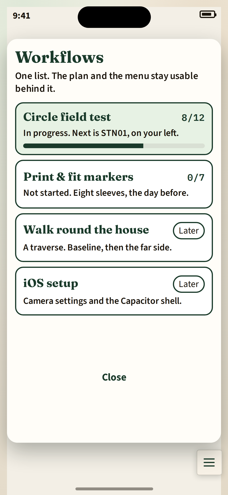
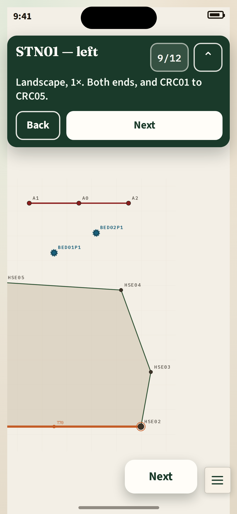
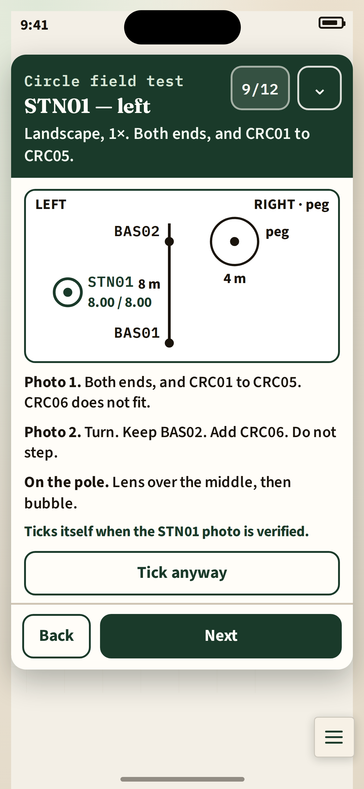
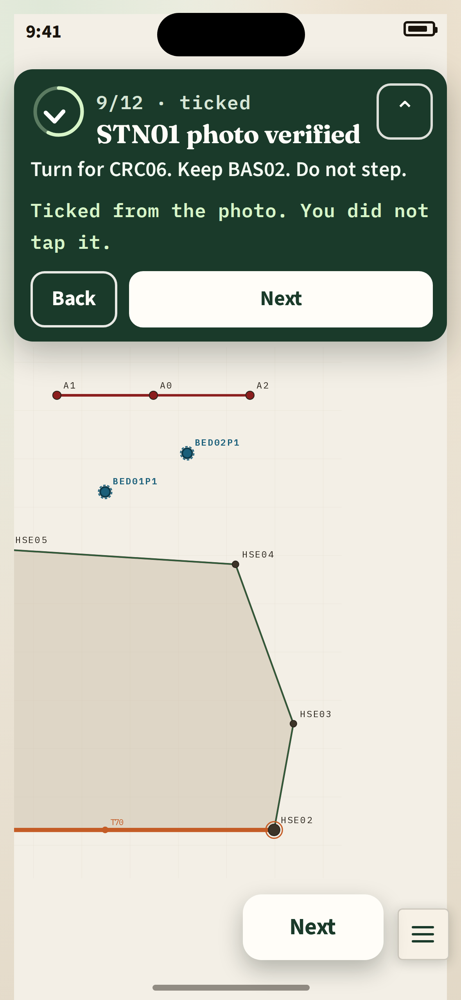
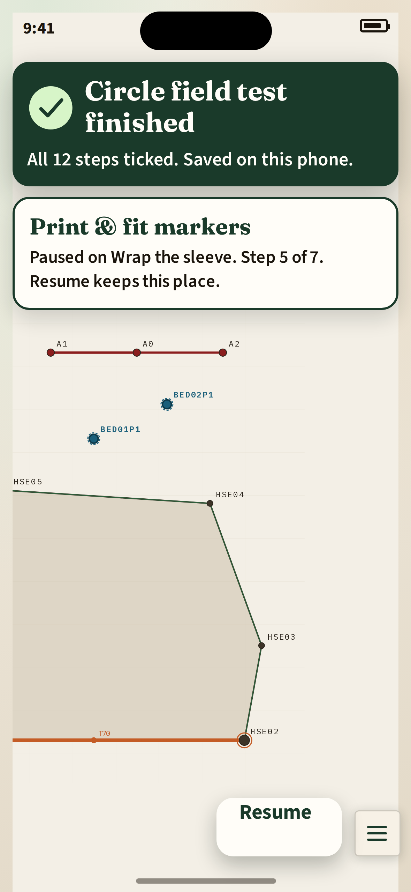
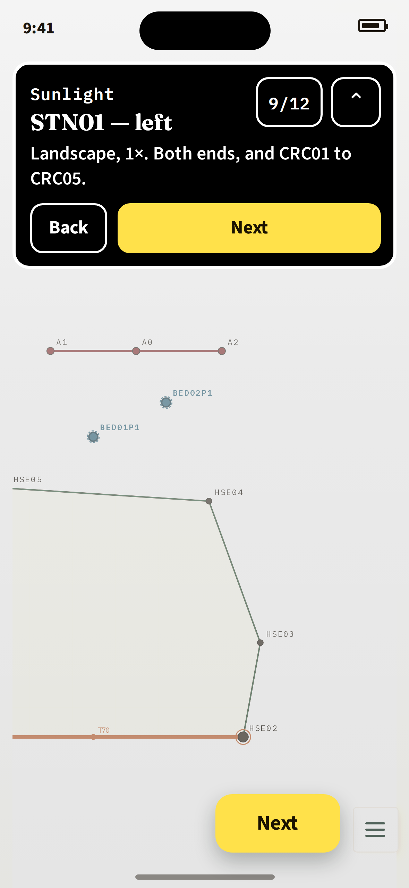

# Guided workflows

**Approved by Paul.** Built in this change. Defaults he set:

- Keep the thumb Next.
- Store progress on the garden document (`workflowProgress`), riding the existing OneDrive save. Older readers ignore the field.
- A surveyor may hand-tick a step the app can detect. The tick is labelled manual until the real event arrives.
- Keep the PDFs until a generated sheet is what gets printed.
- Step sentences live on the workflow, not in `coach.ts`.
- Sleeve R, heights, the laser check, and the station tapes stay in the step note for now.

The circle field sheet and the marker printing sheet ([FIELD_CHECKLIST_CIRCLE.md](../FIELD_CHECKLIST_CIRCLE.md), [PRINT_MARKERS.md](../PRINT_MARKERS.md)) are in-app workflows. `docs/generated/WORKFLOWS.md` is generated from the same data. The survey method does not change. The pictures below are the design mockups; the implementation screenshots are on the pull request.

Pictures, at iPhone 15 size (393×852, 3×), over a capture of the running app:

| | |
|---|---|
| Picker |  |
| Collapsed bar |  |
| Expanded step |  |
| Auto-complete |  |
| Finished and resume |  |
| Sunlight |  |

The throwaway HTML is [guided-workflows/mockup/index.html](guided-workflows/mockup/index.html). Vite’s build entry is the repo `index.html`, so this folder is not in the app bundle or the Pages deploy.

## What the pictures are

`npm run dev`, then Playwright, viewport 393×852, `deviceScaleFactor: 3`, mobile. Chromium reports `env(safe-area-inset-*)` as 0, so the capture rewrote those tokens in the app’s own stylesheets to the iPhone 15 portrait insets (top 59px, bottom 34px, left and right 0) before the shot. The plan is the synthetic demo, pinched with the app’s own viewport transform so the house fills the phone. The mockup draws the Dynamic Island, the clock, and the home indicator on top of that shot, and places the workflow chrome in the safe area.

The menu button in that shot sits at x 338.6, y 774, 44×44. Every workflow surface in the mockup clears that rectangle by at least 12px. The thumb **Next** / **Resume** pill’s right edge is 12px left of the button.

## UX

One workflow is active at a time. The plan stays the backdrop. Chrome is a floating layer with its own box, not a modal over the canvas. Touches outside that box hit the plan, the point dialog, and the menu button.

### Picker

Opened from the hamburger, section **Workflows**. A paper sheet, inset 12px, top just under the safe area, bottom 12px above the menu button. **Close** is a 48px primary at the bottom of the sheet, in the thumb zone.

Four rows, each at least 84px:

| Workflow | In this proposal |
|---|---|
| Circle field test | Full step list below. The picture shows it paused at 8/12, next step STN01. |
| Print & fit markers | Full step list below. |
| Walk round the house | Named only. A traverse, sourced later from [stage-2-field-checklist.md](../stage-2-field-checklist.md). |
| iOS setup | Named only. Camera.app settings from the circle sheet, plus the Capacitor shell when it exists. |

**Later** is a moss outline pill in 16px type, full contrast. The row is not greyed out. It does not start.

### Collapsed bar

Pinned to the top, below the island. Moss card, cream type. It shows:

- step title (Fraunces, 22px)
- one instruction (18px, two lines at most)
- counter, for example `9/12` (16px mono)
- **Back**, **Next** or **Done**, and an expand control, each at least 48px

The picture is step 9 of the circle test: “STN01 — left”, instruction “Landscape, 1×. Both ends, and CRC01 to CRC05.”

**Next** is also a 56px cream pill in the thumb zone, 12px left of the menu button, same action as the bar’s Next. The top of an iPhone 15 is outside a right-hand thumb’s arc. The pill is the one-handed control. It hides while the sheet is open, because the sheet’s **Next** then sits low on the screen.

### Expanded sheet

Same header, plus the diagram and the step’s detail lines, taken from the field sheet. The sheet grows with its content and stops at least 12px above the menu button. It does not dim the plan. The plan shows in the side margins and below the sheet.

The STN01 sheet draws the station: left of the baseline, peg and circle on the right, 8.00 m / 8.00 m. Detail lines are the two photos from the sheet, and the pole check (lens over the middle, then bubble). A line says the step ticks when 2 photos are saved at STN01. That means the OneDrive upload checked out. It does not mean markers were detected. **Tick anyway** is there for an auto step you want to override. A manual-only step has no Tick anyway: **Done** ticks it and moves on. **Back** sits on the foot of the sheet.

### Auto-complete

When a typed app event matches the step, the step ticks without a tap. The frame in the picture is mid-stroke: the ring is part-drawn, the check has turned the corner and started up. The title becomes “2 photos saved at STN01”. The instruction becomes the next physical act: “Turn for CRC06. Keep BAS02. Do not step.” A mono line says “2 photos saved at STN01.” Only photos captured and uploaded after this run started count. `markers.detected` is a typed hook for a later detector. Nothing emits it yet.

If the system reduce-motion setting is on, the tick snaps. No stroke animation. A light haptic plays in the Capacitor shell, and not when reduce-motion is on.

### Resume and finished

Progress is written on every tick, so a locked phone or a killed app comes back on the same step.

The finished picture is both states at once. The circle test is done: “All 12 steps ticked. Saved on this phone.” Print & fit markers is paused on “Wrap the sleeve”, step 5 of 7. The thumb pill says **Resume** and opens that paused step. **Done** on a finished workflow returns to the picker. The finished record stays, so the row can show a tick later.

A workflow whose definition revision has changed keeps ticks whose step ids still exist. Unknown ids are kept on the record and shown as a single line (“An older step is no longer in this list”), not dropped in silence.

## Layout

The menu button is bottom-right, in the thumb zone. From `src/style.css`:

```css
.hamburger {
  bottom: max(0.65rem, env(safe-area-inset-bottom));
  right: max(0.65rem, env(safe-area-inset-right));
  width: 2.75rem;   /* 44px */
  height: 2.75rem;
  z-index: 40;
}
```

On iPhone 15 portrait that is `bottom: 34px`, `right: 10.4px`. The top bar runs the full width inside the safe area. Clearance from the menu button is vertical: workflow chrome ends 12px above that button. The exclusion rect:

```css
--menu-size: 2.75rem;
--menu-gap: 12px;

/* Thumb pill, same bottom edge as the menu button. */
.workflow-thumb {
  right: calc(max(0.65rem, env(safe-area-inset-right)) + var(--menu-size) + var(--menu-gap));
  bottom: max(0.65rem, env(safe-area-inset-bottom));
  height: 56px;
  z-index: 36; /* under the menu button’s 40 */
}

.workflow-bar {
  position: fixed;
  z-index: 36;
  top: env(safe-area-inset-top);
  left: calc(env(safe-area-inset-left) + 12px);
  right: calc(env(safe-area-inset-right) + 12px);
}

.workflow-sheet {
  position: fixed;
  z-index: 36;
  top: env(safe-area-inset-top);
  left: calc(env(safe-area-inset-left) + 12px);
  right: calc(env(safe-area-inset-right) + 12px);
  max-height: calc(
    100dvh
    - env(safe-area-inset-top)
    - max(0.65rem, env(safe-area-inset-bottom))
    - var(--menu-size)
    - var(--menu-gap)
  );
}
```

`viewport-fit=cover` is already on `index.html`. In landscape the notch moves to `safe-area-inset-left` or `right`, and the bar’s left and right follow. Do not lock orientation. The circle test asks for landscape photos. The UI is held in portrait while walking.

The point dialog is a top control (`z-index: 45`, anchored at `env(safe-area-inset-top)`). While it is open, its `top` becomes the bar’s bottom plus 8px, so the bar does not cover Close. The bar stays under the dialog’s z-index. The menu button stays above both.

Pointer events: the bar, the sheet, the thumb pill, and the picker capture their own boxes only. No full-screen scrim.

## Palette and type

Shade and overcast use the app’s moss and paper. The bar is solid moss, not translucent. Translucent chrome washes out in sun.

| Token | Value | Use | Contrast |
|---|---|---|---|
| Moss | `#1a3a2a` | Bar, primary on paper | 12.3:1 against `#fffdf8` |
| Paper | `#fffdf8` | Sheet, Next label on moss | 12.3:1 against moss |
| Instruction on moss | `#f4faf2` | The one-line instruction | above 10:1 |
| Ink | `#1a140c` | Sheet body | above 15:1 on paper |
| Tick green | `#d7f5c8` on moss | The auto tick | large, on the dark bar |

Sunlight is a toggle on the bar, remembered in local prefs. Solid black, a 3px white border, no shadow. Primary buttons are `#ffe14a` with `#1a1200` text (about 16:1). Instruction text is `#ffffff`, not grey. The picture washes the plan out on purpose, so the bar is what still reads.

Type, in CSS pixels. The viewport is already `user-scalable=no`, so this scale is the size the surveyor gets. Nothing in the workflow chrome is under 16px.

| Role | Size | Face | Weight |
|---|---|---|---|
| Step title | 22px | Fraunces | 700 |
| Picker title | 28px | Fraunces | 700 |
| Instruction and sheet body | 17–18px | Source Sans 3 | 600 |
| Counter, eyebrows | 16px | IBM Plex Mono | 600 |
| Buttons | 18px | Source Sans 3 | 700 |
| Thumb primary | 20px | Source Sans 3 | 700 |

Tap targets are at least 48×48px. The thumb primary is 56px tall. Buttons are on the right for the primary and on the left for Back.

## Data model

Workflows are data. A later script can print the markdown from the same objects. UI reads the data. It does not switch on workflow id.

```ts
/** Bump when step ids or completion rules change. */
type WorkflowStatus = 'ready' | 'later';

interface WorkflowDefinition {
  id: 'circle-field-test' | 'print-fit-markers' | 'house-traverse' | 'ios-setup';
  revision: number;
  status: WorkflowStatus;
  title: string;
  summary: string;
  steps: WorkflowStep[];
}

interface WorkflowStep {
  id: string;
  title: string;
  /** One line on the collapsed bar. */
  instruction: string;
  /** Expanded sheet. Sentences from the field doc, not rewritten method. */
  detail: string[];
  /** Optional svg asset id, drawn in the sheet. */
  diagram?: 'circle-plan' | 'stn01' | 'sleeve-bands';
  complete: WorkflowTrigger;
  link: WorkflowLink;
}

type WorkflowTrigger =
  | { on: 'manual' }
  | { on: 'baseline.saved'; endA: string; endB: string; kind: 'tape' | 'laser' }
  | { on: 'photo.uploaded'; stationId: string; minPhotos: number }
  | { on: 'markers.detected'; stationId: string; minPhotos: number }
  | { on: 'photo.marksConfirmed'; pointLabel: string; marks: string[] }
  | { on: 'item.created'; name: string; geometry: 'circle' | 'square' | 'triangle' | 'irregular_polygon' }
  | { on: 'cloud.saved' }
  | { all: WorkflowTrigger[] };

type WorkflowLink =
  | { to: 'none' }
  | { to: 'mode'; mode: 'BASELINE' | 'ADD_POINT' | 'ADD_POINT_EXTRA_YAW' }
  | { to: 'menu'; section: 'baseline' | 'cloud' | 'tools' | 'tie' }
  | { to: 'print-tags' }
  | { to: 'marker-pdf'; file: string };
```

`photo.uploaded` is the OneDrive upload checking out. It is not marker detection. A still with “Not usable for focal length” does not count, and neither does a photo captured or received before the run started. `minPhotos: 2` is the yaw pair (do not step). `baseline.saved` is **Save baseline** with those ends and tape, offsets left at 0. The trigger checks the offsets. A non-zero offset does not complete the circle step. On a manual-only step, **Done** ticks it and advances. **Tick anyway** stays on auto steps.

Events are emitted by the existing save, photo, and sign-in paths. The workflow module does not own the camera.

Opening a step follows `link`: focus that menu section, or set the session mode the button already sets. Marker PDFs are the files in `docs/markers/` until an in-app print view exists.

### Progress

```ts
interface WorkflowProgress {
  version: 1;
  activeId?: WorkflowId;
  /** One run per workflow, so a paused marker sheet survives beside the circle test. */
  runs: Partial<Record<WorkflowId, {
    workflowId: WorkflowId;
    revision: number;
    currentStepId: string;
    updatedAt: string;
    finishedAt?: string;
    parkedStepIds?: string[];
    steps: Record<string, {
      status: 'pending' | 'complete';
      completedBy: 'manual' | 'auto' | null;
      completedAt?: string;
      /** Write-in the app cannot store yet: two baseline pulls, sleeve R, height. */
      note?: string;
      seen?: string[];
    }>;
  }>>;
}
```

Manual tick is allowed on an auto step. The record says `completedBy: 'manual'`. The bar says “Ticked by you.” When the real event arrives later, `completedBy` becomes `auto`. A manual tick is how a failed upload does not block the afternoon.

## Circle field test

Twelve steps. Wording is the approved sheet, [FIELD_CHECKLIST_CIRCLE.md](../FIELD_CHECKLIST_CIRCLE.md). The longer protocol ([FIELD_PROTOCOL_CIRCLE.md](../FIELD_PROTOCOL_CIRCLE.md)) is the same visit. Look from BAS01 toward BAS02. Left is left. The peg is on the right.

| # | Title | Completes when | Opens |
|---|---|---|---|
| 1 | Kit | Manual | — |
| 2 | Set out the circle | Manual | — |
| 3 | Check the diameters | Manual | — |
| 4 | Place BAS02 and BAS01 | Manual | — |
| 5 | Tape the baseline both ways | Manual note of both pulls, and `baseline.saved` tape BAS01–BAS02 | Menu → Baseline |
| 6 | Laser CHK-BASE | Manual. Not typed into the app | — |
| 7 | Plumb and height | Manual, one tick per cane | — |
| 8 | Calibration CAL | `photo.uploaded` CAL, 1 photo. Start the run first; an earlier shot does not count. On iOS, the in-app camera, same path and lens as the stations. | + Point, name CAL |
| 9 | STN01 — left, 8.00 / 8.00 | `photo.uploaded` STN01, 2 photos | + Point, name STN01 |
| 10 | STN02 — right, 6.50 / 9.00 | `photo.uploaded` STN02, 2 photos | + Point, name STN02 |
| 11 | STN03 — right, 10.50 / 10.50 | `photo.uploaded` STN03, 2 photos | + Point, name STN03 |
| 12 | Save and send | `cloud.saved` | Menu → Sign in |

Detail lines, in order:

1. **Kit.** One iPhone, rear camera, zoom 1×, landscape, same phone for every photo including the calibration. A tape that reaches 8 m clear. A laser, or a tape that reaches 10.5 m. A non-stretch line marked at 4.000 m. A centre peg, six circle canes, two baseline canes, one calibration cane if you do not reuse a circle cane. Sleeves glued snug on a 60 mm dowel, matte, each with its own R. A spirit level and the phone pole, about 1 m. Camera location off. Offset A and Offset B stay 0.
2. **Set out the circle.** Peg in the lawn. Line on the peg, 4.000 m to the stick axis. Plant CRC01 nearest the baseline. Each next cane is 4.000 m from the peg and 4.000 m from the one before: CRC02, CRC03, CRC04, CRC05, CRC06. Closing chord CRC06–CRC01 within 30 mm of 4.000 m, or walk them again. Diagram: `circle-plan`.
3. **Check the diameters.** CRC01–CRC04 and CRC02–CRC05, tape level, axis to axis 8.000 m. Both within 20 mm. Then write radius σ 3 mm. Outside those limits, walk the sticks again. Do not write a larger σ.
4. **Place BAS02 and BAS01.** From the peg through CRC01, 4.30 m is BAS02, about 0.30 m past CRC01. Write the distance you taped. Baseline square to that line. From BAS02 back toward the peg mark 3.00 m. From that mark swing 5.00 m, and from BAS02 swing 4.00 m. Through that side point, BAS01 is 8.000 m from BAS02.
5. **Tape the baseline both ways.** Sleeve to sleeve, level. Level each reading, then add that end’s measured R. The two axis lengths must agree within 10 mm. The mean is the length you type. Do not average a pair that disagrees by more than 10 mm. The two readings live in the step note. The app gets the mean only.
6. **Laser CHK-BASE.** Same baseline, sleeve to sleeve, same height. This is not typed into the app. Retake if the dot is more than half that sleeve’s R (about 15 mm) off the middle. Level, then add R for each sleeved end.
7. **Plumb and height.** Bubble every cane: CRC01–CRC06, BAS01, BAS02, CAL. Middle of the bubble, about 1°. A 2° lean at 0.5 m sleeve height is 17 mm. Write height to the middle of the paper. 0.5 m is a good target. Tick plumb only when the bubble passed. The app has no box for R, height, or plumb. They stay on the step.
8. **Calibration CAL.** Before any station. One plumbed cane. Front of the phone about 4.000 m from the paper, between 3 m and 5 m. Tape that, level, write the raw reading. Axis length is the reading plus that sleeve’s R. One still. Name it CAL.
9. **STN01 — left.** 8.00 m / 8.00 m. Photo 1: both baseline ends, and CRC01, CRC02, CRC03, CRC04, CRC05. CRC06 does not fit. Photo 2: turn, keep BAS02, add CRC06. Do not step. 1×, landscape, lens glass over the middle of the pole, pole bubbled, then shoot. Diagram: `stn01`.
10. **STN02 — right.** 6.50 m from BAS01, 9.00 m from BAS02, outside the circle. Photo 1: both baseline ends. No circle stick between them. Photo 2: turn, keep BAS02, take CRC02, CRC01, CRC06, CRC03. Do not take CRC05. It sits behind CRC03. Do not photograph CRC04 from here.
11. **STN03 — right.** 10.50 m / 10.50 m. Required. Two stations are not a finished test. Photo 1: both baseline ends, and CRC01, CRC02, CRC03. Photo 2: turn, keep BAS02, add CRC06, CRC05, CRC04.
12. **Save and send.** New garden if this phone should not keep an older one. Sign in. Baseline End A BAS01, End B BAS02, length is the tape mean, offsets 0, Measure with Tape. + Point, name Circle, geometry Circle. Stations and CAL from Library at Actual Size, not the in-app shutter. Mark A on BAS01 and B on BAS02, then Confirm. Each Photo row must read verified. Save. Wait until the file is on OneDrive. Version `1` is `/Garden Survey/garden-v1.json`.

Tape from the pole to the sleeve, level, add R once, for the sleeve end only. Those station tapes are written on the step. The app has no box for them. Side is not typed as 0 or 1. The step title already says left or right.

## Print & fit markers

Seven steps, from [PRINT_MARKERS.md](../PRINT_MARKERS.md). All manual. The app cannot see a ruler or a dowel. The print step opens the PDF for that sleeve.

| # | Title | What the sheet says |
|---|---|---|
| 1 | Assign the sleeves | BAS01 315, BAS02 36E, CRC01 459, CRC02 6BA, CRC03 8A3, CRC04 952, CRC05 DAC, CRC06 EC5. Pencil the code on the dowel. STN01, STN02, and STN03 are not sleeved. Calibration reuses a cane. No ninth code. No checkerboard. |
| 2 | Print at actual size | A4 portrait, 210×297 mm. Actual size / 100%. No fit-to-page, no shrink, no scaling, no borderless, no two-up. Highest quality. Black only. Colour management off. Link: `docs/markers/all-sleeves.pdf` and the eight single pages. |
| 3 | Check the rulers | The 100 mm bar must be 100 mm within ±0.5 mm. The 50 mm bar is on the blank tab. The sheet also has 250 mm down the tab and 180 mm along the bottom legend. A miss means the driver scaled the page. Reprint. Do not use that sheet. The four black bars at TOP are the sync. Together they are 52 mm. |
| 4 | Paper and film | Matte. Laser or pigment on matte polypropylene or polyester. If paper: matte, 120–160 gsm, not dye. Matte film over toner only. After any film, measure the 100 mm bar again. Gloss blinds the reader. Keep the sheets dry until the glue has set. |
| 5 | Cut | Laminate first if you use film. Summary: Left: just inside the dash. Right: on the right-hand dashed line, or the sheet edge. Cut just inside the CUT HERE dash, between the dash and the bands (about 4.4–5.0 mm), so the band ink runs to the cut edge. Inside is toward the bands. The dash ink ends near 4.35 mm and the bands start near 4.50 mm; cutting on the dash leaves a white sliver. Cut 5 mm off the top and the bottom. Do not crease the fold. |
| 6 | Join the sleeve | Fix the blank tab to the 60 mm dowel first, with flush staples, flush pins, glue, or tape. Staples only in the blank, at least 4 mm from the fold, never through the bands. Wrap snug, printed face out, TOP up, without creasing the fold. Square the wrap on the 195 mm fold crosses. A 1° spiral costs about 3.3 mm. Stick the cut left edge down over the tab with glue or thin double-sided tape. Turn the seam away from the stations and the camera, and keep it off the middle of the calibration photo. Diagram: `sleeve-join`. |
| 7 | Measure R, height, and plumb | After the glue is dry, and after any film. Three heights. Paper strip or cloth tape, not a steel tape. R = C / 2π, to 0.1 mm. One R per sleeve. Height to the middle of the paper. 0.5 m is the target. Write the height you measure. Bubble in two directions, about 1°. App offsets stay 0. |

## Persistence

Approved: an optional `workflowProgress` field on the garden document, same pattern as `photosManifest`. Older readers ignore it. It is small, no photo bytes. A surveyor tick goes through the existing save path: it marks the garden dirty and the save queue uploads it. The garden’s own conflict copy is the conflict copy for the ticks. Do not merge ticks in a second file. The `cloud.saved` tick is a normal edit. It dirties the garden, bumps the revision, and queues one follow-up save against the eTag just stored. Once that step is already complete, another `cloud.saved` changes nothing, so the follow-up does not queue a further save. A reload before that follow-up is dirty, so sign-in does not silently adopt the OneDrive copy that still has the step open.

A local mirror, `localStorage` key `garden-survey:workflow-progress`, is written on every tick, with the garden’s `createdAt` and its OneDrive path. It is read only when the document has no `workflowProgress` and both of those match. A field already on the document wins, so a newer OneDrive copy is not overwritten. Sunlight is a separate pref (`garden-survey:workflow-sunlight`) and does not dirty the survey. Start over asks first, then keeps that run’s notes (sleeve R, heights, CHK-BASE) on `pastRuns` and begins again at step 1.

The step `note` holds the write-in numbers until the model has real boxes for sleeve R, height, plumb, the laser check, and the station tapes. Those boxes are not part of this proposal.

## Capacitor

The shell is not in the repo yet. This build adds no Capacitor plugin. Insets are `env(safe-area-inset-*)`. Progress uses `localStorage` and the garden document, which the app already uses. These are the constraints for when the shell exists.

- Insets come only from `env(safe-area-inset-*)`. If the native status bar also pads the web view, the bar sits twice as low. Overlay the web view and let CSS do the inset.
- `localStorage` in WKWebView can be dropped under storage pressure. When `window.Capacitor` is present, write the same progress through Preferences as well as `localStorage`.
- Keep the screen awake while a workflow is active, so it does not sleep between stations.
- Haptic on auto-tick. Off when reduce-motion is set.
- `window.print()` is unreliable in WKWebView. The marker print step uses the share sheet, or the PDF, until a print plugin exists.
- Sign-in needs a custom-scheme redirect in Entra as well as the GitHub Pages SPA redirect. Progress sync uses the same account. This proposal does not redesign auth.
- On iOS the calibration still uses the in-app camera, the same capture path and lens as the station photos. fx is per lens and per resolution. Auto-complete stays on `photo.uploaded`, which rejects a still with no focal length.
- Resume on `appStateChange`. A kill mid-step reopens `currentStepId`.

## Implementation plan

Built together in this change, in the modules below. None of it changes the survey method. The original split is kept here so a later pass can see what was in scope.

1. **Definitions.** `src/workflows/guided/types.ts` plus the circle and marker objects, and the two `later` stubs with empty steps. Tests: unique step ids, every trigger and link is one of the types above. No UI.
2. **Generated sheet.** A script writes markdown from those objects into `docs/generated/`. The current PDF build stays until that sheet is the one you print.
3. **Progress store.** Read and write the local key. Revision mismatch keeps surviving step ids. Tests with a memory `localStorage`. No UI.
4. **Picker.** First PR that touches `src/ui.ts`. A Workflows section in the hamburger. Starting a ready workflow stores progress and follows the first step’s link. No floating bar yet.
5. **Collapsed bar and thumb pill.** New `src/guidedChrome.ts`, wired thinly from `ui.ts`. A layout test checks the chrome box against the hamburger exclusion rect at the iPhone 15 insets.
6. **Expanded sheet and the three diagrams.** Pass-through hits outside the sheet.
7. **Events.** Emit the typed events from baseline save, photo verified, marks confirmed, item created, and OneDrive save. Manual tick. CSS tick, snapped when reduce-motion is set.
8. **Deep links.** Each step’s `link` focuses a menu section or mode that already exists.
9. **OneDrive field.** Optional `workflowProgress` on the document. Conflict line in the coach when both copies moved.
10. **Sunlight toggle.** Tokens above, stored in local prefs.
11. **Capacitor pass.** Only once the shell exists. Keep-awake, haptics, Preferences mirror, safe-area check on a device.

The house traverse and iOS setup get their own definition PRs when those sheets are written. Until then the rows stay **Later**. The Stage 2 panel in Tools stays until the house workflow replaces it.

## Approved

Paul approved the six open questions as follows.

1. The thumb **Next** stays. It repeats the bar’s Next, and it hides while the sheet is open.
2. Progress is the optional `workflowProgress` field on the garden document. A local mirror (`garden-survey:workflow-progress`) is written on every tick and read only as a fallback when the document has no workflow field and both `createdAt` and the OneDrive path match. A field already on the document is left alone. `cloud.saved` dirties the garden and queues one follow-up save.
3. A hand tick completes an auto step and is labelled manual. When the real event arrives later, `completedBy` becomes `auto`.
4. The PDFs stay until a generated sheet is the one that prints. `docs/generated/WORKFLOWS.md` is the reference, checked in CI.
5. Step sentences live on the workflow. `coach.ts` stays the session-mode coach.
6. Sleeve R, heights, the laser check, and the station tapes stay in the step note.
