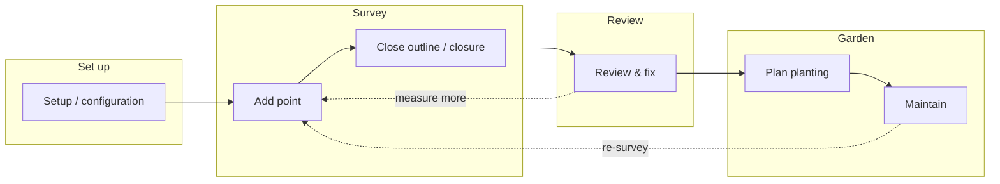

# App overview — the smallest set of activities

Six activities in four groups. Each activity is one screen flow; the layer or option chosen at the start sets the rules (from configuration, held in JSON).

| Group | Activity | Purpose (one line) | Layer | Status |
|---|---|---|---|---|
| Set up | **Setup / configuration** | Set tolerances, focal length, default baseline and other settings, saved as JSON. | All | Not yet designed (values agreed: 30/30/100/150/200 mm) |
| Survey | **Add point** | Add one point: choose layer, pick a fix option, take tape measurements / photo clicks, check measurement strength. | Baseline or measurement (railway, flower bed, tree) | **Modelled** — `add-point.net.yaml` |
| Survey | **Close outline / closure** | Finish an outline (close), then closure compares the closing gap with the closing uncertainty. | Measurement | **Modelled** (flower bed) — `two-steps.net.yaml`, Step B |
| Review | **Review & fix** | Re-solve, history view, remove duplicate measurements, switch side choice, delete point (with frame refit). | All | Rules agreed; flow not yet designed |
| Garden | **Plan planting** | Place plants and beds on the surveyed plan. | Measurement | Not yet designed |
| Garden | **Maintain** | Record later changes and re-surveys over time. | All | Not yet designed |

Notes
- "Add a baseline point" is now just **Add point** with the baseline layer chosen.
- Every measurement is kept in the observation log in the order taken; Review & fix reruns the whole calculation from it.

